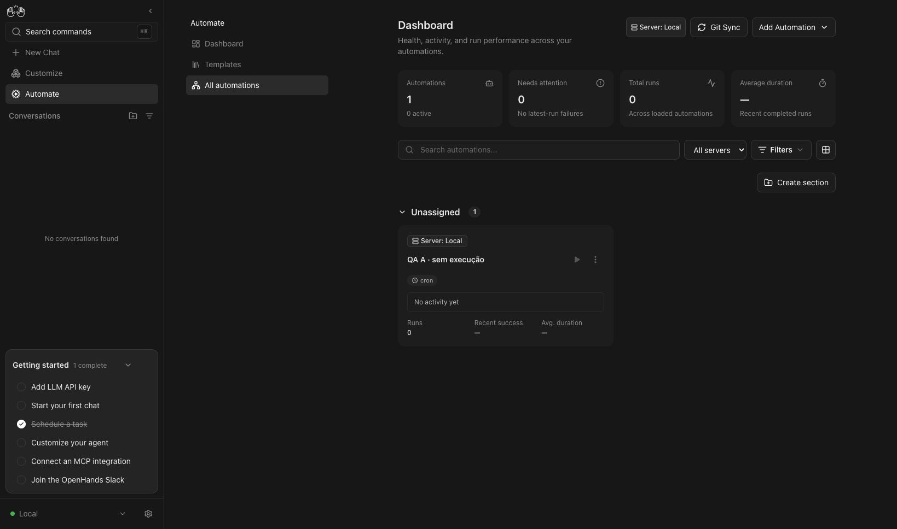

# Existing global dashboard route mapping

Independent verification maintenance prepared after the product agent reported an unmapped fork route. This PR changes only the F21 route/source inventory plus this evidence; no product code, tests, expectations or verifier implementation changes.

- Baseline: `3bb4ce72c` from Canvas update PR #13.
- Before: `map coverage` rc=1; the only unmapped route is `/automations/all` (`src/routes/all-automations.tsx`).
- Source: that module re-exports `global-automations-dashboard` and the existing list loader; the route is already implemented in the fork.
- After: `map coverage` rc=0; 33 routes, none unmapped; 29 feature directories, none unmapped (existing context-menu exclusion unchanged).
- `map check --file F21-automations-dashboard.md` and full `map check`: rc=0.
- `npx vitest run .agents/skills/verify-openhands/scripts/control-openhands.test.mjs --maxWorkers=1`: rc=0, 79 tests passed. An initial invocation using Node native test runner failed because this is a Vitest file; corrected to its documented Vitest command.

## Live route proof

Read-only browser verification through CUA against the existing isolated real stack on localhost:18820 (Canvas 1.34 build with AgentServer1.58.1 and Automation1.26). The direct `/automations/all` route renders Dashboard, the All servers selector and an inactive QA automation. Clicking Dashboard then All automations returns to `/automations/all` with the same heading. No fixture, backend, production state or agent execution changed. A fresh browser profile skipped onboarding; no API/model credential was entered.

This is narrow route inventory proof, not a new full F21 functional verification. The product PR owns broader cross-backend evidence. The route module and registration already exist unchanged in base `93571708e263ef446d9dfad23449a39a74bfd317`. This is independent inventory maintenance for a pre-existing fork feature, not a specification change for a new product fix. The separate PR/context requirement applies; the instruction to follow a product fix after it lands does not require waiting for this version-integration PR. Review this map-only PR independently before integrating it into the update branch; PR #13 must then be revalidated at its new HEAD.
